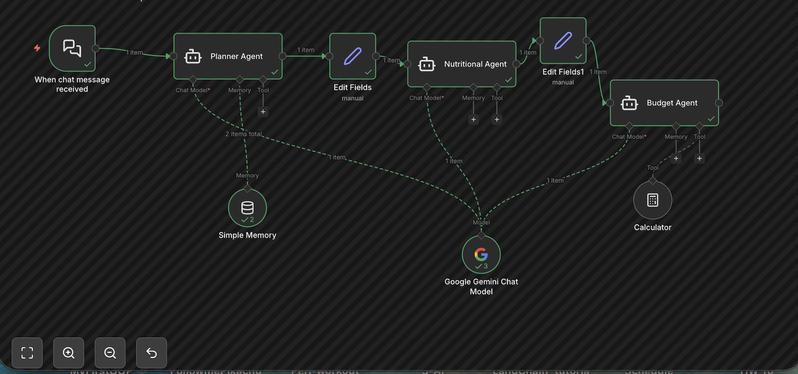

# Healthy Shopping AI Agent

### A Multi-Agent AI System for Personalized Grocery Recommendations

A multi-agent artificial intelligence project designed to help users make healthier grocery shopping decisions while staying within their budget.

Developed as part of **CS 351 – Software Engineering II**, this project demonstrates how specialized AI agents can collaborate to interpret user requirements, recommend grocery items, and estimate shopping costs.

---

## Project Overview

Healthy Shopping AI Agent is a conversational AI system that generates personalized grocery recommendations based on a user's budget, dietary preferences, restrictions, and health goals.

Instead of relying on a single AI agent to handle every task, the system distributes responsibilities across three specialized agents:

- **Planner Agent** – Understands the user's request and organizes their requirements.
- **Nutritional Agent** – Recommends grocery items based on dietary needs.
- **Budget Agent** – Estimates prices, calculates total costs, and adjusts recommendations to fit the user's budget.

The workflow is implemented using **n8n** and **Google Gemini**, with automated data transfer between agents.

---

## Project Objectives

- Develop a multi-agent system for personalized grocery recommendations.
- Support different dietary preferences and restrictions.
- Generate grocery suggestions based on individual health goals.
- Estimate shopping costs and consider budget limitations.
- Demonstrate communication and task delegation between AI agents.
- Explore practical applications of AI in everyday decision-making.

---

## Technologies Used

| Technology | Purpose |
|------------|---------|
| n8n | Workflow automation and agent orchestration |
| Google Gemini | Large language model powering the AI agents |
| AI Agents | Specialized task processing and decision-making |
| Simple Memory | Maintains conversational context for the Planner Agent |
| Calculator Tool | Supports numerical calculations for the Budget Agent |
| JSON | Workflow configuration and data exchange |
| Docker | Local deployment environment for n8n |

---

## Multi-Agent Architecture

The system follows a sequential multi-agent architecture in which each agent performs a specific task before passing information to the next stage.

### Workflow Diagram



### Workflow Sequence

```text
User Shopping Request
         |
         v
    Chat Trigger
         |
         v
    Planner Agent
    + Simple Memory
         |
         v
     Edit Fields
         |
         v
  Nutritional Agent
         |
         v
     Edit Fields
         |
         v
     Budget Agent
     + Calculator
         |
         v
  Grocery Recommendations
  with Estimated Prices
```

All three agents use Google Gemini as their language model.

---

## AI Agent Responsibilities

### 1. Planner Agent

The Planner Agent receives the user's shopping request and identifies the information needed to generate personalized recommendations.

**Responsibilities:**
- Extract the user's shopping budget.
- Identify dietary restrictions and preferences.
- Identify health and nutrition goals.
- Organize the extracted information for the next agent.

The Planner Agent is connected to a Simple Memory component to support conversational context.

### 2. Nutritional Agent

The Nutritional Agent uses the shopping requirements to recommend grocery items.

**Responsibilities:**
- Consider dietary restrictions.
- Consider the user's health goals.
- Recommend appropriate grocery items.
- Return a list of suggested foods without prices.

This separation allows the Nutritional Agent to focus on food selection rather than cost calculations.

### 3. Budget Agent

The Budget Agent receives the grocery recommendations and budget information.

**Responsibilities:**
- Assign estimated prices to grocery items.
- Calculate the estimated total cost.
- Compare the total against the user's budget.
- Adjust quantities when necessary.
- Return the shopping list with estimated prices.

The Budget Agent has access to a Calculator tool for numerical operations.

**Note:** Prices are AI-generated estimates rather than verified real-time grocery store prices. Budget compliance is requested through the agent instructions and is not independently guaranteed.

---

## How the System Works

1. The user enters a shopping request through the n8n chat interface.
2. The Planner Agent identifies the budget, diet, and health goals.
3. An Edit Fields node prepares information for the Nutritional Agent.
4. The Nutritional Agent generates grocery recommendations.
5. A second Edit Fields node prepares the grocery list and budget information.
6. The Budget Agent estimates prices and calculates the total.
7. The system produces a budget-aware grocery recommendation.

### Example Input

```text
I have a $75 budget for groceries.

I want high-protein meals and would
prefer to avoid dairy products.

Can you recommend a shopping list?
```

### Illustrative Output

```text
Suggested Grocery List:

Chicken breast       $15.00
Eggs                  $6.00
Brown rice            $5.00
Black beans           $4.00
Spinach               $4.00
Broccoli              $5.00
Oats                  $5.00
Almond milk           $4.00
Bananas               $3.00
Peanut butter         $5.00

Estimated Total:     $56.00
Budget:              $75.00
Remaining:           $19.00
```

*This example is illustrative, not a recorded workflow execution. Actual recommendations and prices may vary.*

---

## Project Files

| File | Description |
|------|-------------|
| `README.md` | Project documentation |
| `healthy_shopping_workflow_public.json` | Exported n8n multi-agent workflow |
| `healthy_shopping_workflow.png` | Workflow architecture screenshot |

### Workflow Source

[View the n8n Workflow JSON](healthy_shopping_workflow_public.json)

---

## How to Run the Project

### Prerequisites

- Docker Desktop or another supported n8n installation
- n8n
- Google Gemini API credentials

### Instructions

1. Start your n8n environment.
2. Open the n8n workflow editor.
3. Create a new workflow.
4. Import `healthy_shopping_workflow_public.json`.
5. Configure your own Google Gemini API credentials.
6. Verify that the model, memory, and agent connections are configured correctly.
7. Review the Edit Fields expressions and prompt mappings for compatibility with your n8n version.
8. Save the workflow and open the chat interface.
9. Enter a shopping request containing a budget, dietary preferences, and health goals.
10. Run the workflow and review the generated recommendations.

The public workflow does not include private API credentials.

---

## Limitations

The current implementation is a prototype and has several limitations:

- Grocery prices are estimated by the AI rather than retrieved from live stores.
- Recommendations are not verified against real-time inventory.
- Nutritional information is not independently validated against a food database.
- Agent-generated results may vary between executions.
- Budget compliance depends on the workflow's prompts and calculations.
- The system is intended for educational demonstration rather than professional dietary advice.

---

## Future Improvements

Potential future enhancements include:

- Integrating real grocery store prices and product databases.
- Adding nutritional information from verified sources.
- Supporting location-based grocery store recommendations.
- Developing a dedicated web interface.
- Implementing automatic budget validation.
- Comparing recommendations across multiple grocery stores.
- Adding more extensive testing and performance evaluation.

---

## Project Team

**Lorena Ramirez**  
**Carlos Nunez**

**Course:** CS 351 – Software Engineering II  
**Project:** Healthy Shopping AI Agent

---

*An academic project exploring multi-agent artificial intelligence, workflow automation, and personalized decision support.*

